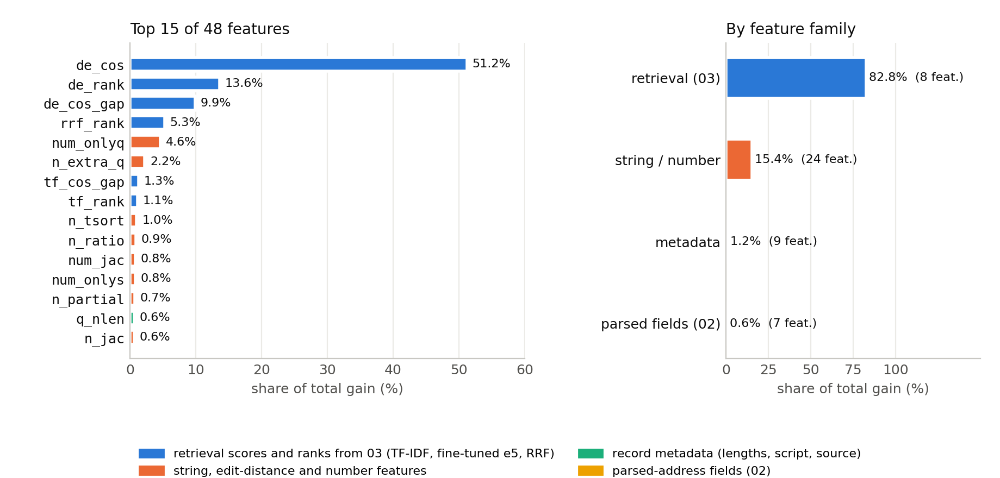

# Report section: Classical baseline

**Author:** Keshav (issues #5, #6) · **Notebook:** `04_gbm_baseline` · **Analysis:** `analysis/paired_bootstrap.py`, `analysis/gbm_importance_plot.py`
**Course topics:** edit distance, string similarity, n-grams, feature-based classification

Figure: `analysis/out_gbm/gbm_feature_gain.png`. Tables: `analysis/out_gbm/gbm_feature_importance.csv` (gain of all 48
features), `analysis/out_gbm/gbm_feature_families.md`. Outputs: the `er-04-output` Kaggle dataset (`results/`,
`scores/` for 07, `preds/`, `models/gbm.txt` for 08).

---

## G.1 Model and features

The baseline is a **gradient-boosted tree classifier (LightGBM)** on hand-built features of each candidate pair: an
S2/S3 record `q` and one of its five S1 candidates `s` from `03_candidates`. It scores exactly the same pairs as every
other matcher and uses the same decision rule (each record goes to its best candidate if p ≥ threshold).

**48 features in six families:**

| family | features | what they measure |
|---|---|---|
| **name strings** (14) | `n_ratio`, `n_tset`, `n_tsort`, `n_partial`, `n_jw`, `n_jac`, `core_ratio`, `core_eq`, `n_extra_q`, `n_extra_s`, `legal_conflict`, `n_ratio_gap`, `core_ratio_gap`, `n_ratio_rank` | edit-distance similarity of the normalised names: Indel ratio, token-set / token-sort / partial ratio, Jaro-Winkler, word Jaccard; the same on the *core* name (legal suffix removed); words only in `q` or only in `s`; two different legal forms (`pvt ltd` vs `llp`) |
| **address strings** (6) | `a_ratio`, `a_tset`, `a_tsort`, `a_partial`, `a_jac`, `a_tset_gap` | the same similarities on the normalised address |
| **numbers** (4) | `num_jac`, `num_onlyq`, `num_onlys`, `first_num_eq` | the digit strings in the two addresses (house, plot, shop, door numbers): Jaccard, how many appear only in `q` / only in `s`, first number equal |
| **parsed fields** (7) | `house_eq`, `house_ratio`, `city_ratio`, `street_tset`, `locality_tset`, `post_eq`, `q_landmark` | field-by-field comparison of the BiLSTM-CRF parses from 02 (Section P); −1 when a field is missing |
| **retrieval** (8) | `tf_cos`, `tf_rank`, `de_cos`, `de_rank`, `rrf_rank`, `n_cand`, `tf_cos_gap`, `de_cos_gap` | 03's TF-IDF char-3-gram cosine, fine-tuned e5 bi-encoder cosine, their ranks, the fused RRF rank |
| **metadata** (9) | `q_latin`, `q_devanagari`, `q_malayalam`, `q_other_indic`, `q_src3`, `q_addr_empty`, `q_nlen`, `s_nlen`, `q_alen` | script and source of `q`, empty address, text lengths |

The `_gap` and `_rank` features compare a candidate with the **other candidates of the same record**: `x_gap` is its
value minus the best value among them (0 for the leader). The decision is relative (does this S1 beat the other four?),
so the model needs to know whether a candidate is a clear winner or one of several near-identical branches.

**Training.** `LGBMClassifier` with 63 leaves, learning rate 0.05, at least 50 samples per leaf, 80 % row and column
sampling, up to 3,000 trees with early stopping on val log-loss (patience 100). Trained on the **part-A** candidate
pairs of train (1.51M pairs), CPU only: **1,609 trees in 4.6 min**. The test logits are saved for the fusion in 07.

## G.2 Results

Held-out test split, threshold tuned on val.

| model | test F0.5 | P | R | F0.5 India | F0.5 US | singleton acc | train |
|---|---|---|---|---|---|---|---|
| mDeBERTa-v3 full fine-tune (06f) | 0.99402 | 0.9953 | 0.9931 | 0.99533 | 0.99261 | 0.9866 | 60.4 min GPU |
| bge-reranker-base full fine-tune (06b) | 0.99124 | 0.9941 | 0.9878 | 0.99299 | 0.98935 | 0.9840 | 19.4 min GPU |
| **LightGBM (04)** | **0.99081** | 0.9938 | 0.9873 | 0.99205 | 0.98946 | 0.9857 | **4.6 min CPU** |
| bge LoRA r=16 (06c) | 0.98708 | 0.9900 | 0.9854 | 0.98839 | 0.98566 | 0.9681 | 10.1 min GPU |
| Siamese char-BiLSTM (05a) | 0.98335 | 0.9863 | 0.9846 | 0.98284 | 0.98390 | 0.9454 | 13.3 min GPU |

- The GBM is the **third-best single model**: 0.0004 behind the fully fine-tuned 278M-parameter cross-encoder (06b),
  ahead of LoRA, the MoE-head cross-encoder, IndicBERTv2, Ditto and all recurrent matchers. It trains on a CPU in under
  5 minutes, and its singleton accuracy (0.9857) is second only to mDeBERTa.
- **Per script** (Section S.2): 0.9889 on US Latin (bge full fine-tune: 0.9887), 0.9924 on Devanagari, 0.9909 on
  Malayalam, and 1.000 on the 283 "other Indic" records, the best of all single models there. With 283 records
  (17 unlinked), that last number is too small for strong claims.

## G.3 What the model uses: feature importance

*Share of the total split gain per feature (left, top 15 of 48) and per family (right). Run with the BiLSTM-CRF
fields; the run with the rule fields has the same order.*

| feature family | features | share of gain |
|---|---|---|
| retrieval scores and ranks from 03 | 8 | **82.8 %** |
| string, edit-distance and number features | 24 | 15.4 % |
| &nbsp;&nbsp;of which name strings | 14 | 7.7 % |
| &nbsp;&nbsp;of which numbers in the address | 4 | 6.5 % |
| &nbsp;&nbsp;of which address strings | 6 | 1.2 % |
| record metadata | 9 | 1.2 % |
| parsed-address fields (02) | 7 | 0.6 % |

The five strongest features:

1. **`de_cos`** (51 %): cosine similarity under 03's **fine-tuned multilingual-e5** bi-encoder. It was trained on this
   matching task, and it reads the original-script name next to its romanisation, so it already captures most of the
   signal, including Devanagari or Malayalam names against their Latin spelling, where string ratios fail.
2. **`de_rank`** (14 %): the rank of this S1 among the dense neighbours of `q`. A cosine of 0.85 is a match if it is
   the best candidate and a non-match if three others are higher.
3. **`de_cos_gap`** (10 %): how far the candidate is behind the best dense candidate. It separates a clear winner from a
   near-tie between branches of the same chain.
4. **`rrf_rank`** (5 %): the rank after fusing TF-IDF and dense retrieval. It adds the cases where the two retrievers
   disagree.
5. **`num_onlyq`** (5 %): how many numbers in `q`'s address do **not** appear in `s`. This is the strongest hard
   *negative* signal: two branches of one chain have near-identical names and different street numbers, and the
   embeddings blur exactly that difference.

**So this is not a pure edit-distance model.** It is a classical learner **on top of a neural retriever**: 83 % of its
gain comes from 03's scores, and the classical features add what the embeddings miss: numbers (6.5 %), extra or
missing name words, legal-form conflicts. The address information it uses is mostly the *numbers*; address string
similarity and the parsed fields together get under 2 %. We did not run the GBM without the retrieval features, so how
well a purely string-based model would do on this data is an open question.

## G.4 Does the BiLSTM-CRF parser help? A paired bootstrap

The GBM was run twice, identical except for the source of the 7 parsed-field features:

| parsed fields from | threshold | val F0.5 | test F0.5 | test P | test R | singleton acc | trees |
|---|---|---|---|---|---|---|---|
| BiLSTM-CRF (02) | 0.36 | 0.99286 | **0.99081** | 0.9938 | 0.9873 | 0.9857 | 1,609 |
| rules (no 02) | 0.33 | 0.99275 | **0.99051** | 0.9931 | 0.9879 | 0.9832 | 1,722 |

Is the +0.0003 real? Test F0.5 is a mean over the 21,529 test S1 entities, so we use a **paired bootstrap over
entities** (`analysis/paired_bootstrap.py`): compute each entity's F0.5 under both runs, resample the entities with
replacement 10,000 times (the same entities for both runs), and take the 2.5 and 97.5 percentiles of the mean
difference.

- Difference +0.00030, 95 % interval **[−0.00006, +0.00064]**: it **includes 0, so not significant**.
- The runs differ on only **273** entities: 137 better with the BiLSTM-CRF, 136 better with the rules.

This is expected. Every non-empty address in the data has its commas, and with commas the BiLSTM-CRF reproduces the
rule parse on 99.7 % of addresses (Section P.4), so the two runs see nearly the same fields. And the parsed-field
features carry only 0.6 % of the gain anyway. The parser's advantage, comma-free addresses, does not occur in this data.

## G.5 The GBM in the fusion

In the gated Mixture-of-Experts (07, Section B), the GBM is the expert the gate trusts most. Mean gate weight per
script on test (9-expert run, `moe_gate_by_script.csv`):

| script | GBM | mDeBERTa-v3 | the other 7 experts together |
|---|---|---|---|
| Latin | 0.60 | 0.36 | 0.03 |
| Devanagari | 0.74 | 0.23 | 0.03 |
| Malayalam | 0.75 | 0.24 | 0.01 |
| other Indic | 0.91 | 0.09 | 0.01 |

The fusion is essentially **GBM + the best cross-encoder**. The two are the most *different* experts: the GBM decides
from retrieval scores and explicit number and word mismatches, mDeBERTa from reading both records jointly. The other
cross-encoders read the records the same way mDeBERTa does and, judging by their near-zero weights, add little on top
of it. The weight moves toward the GBM on Indic scripts.
This is consistent with its strongest feature, the e5 similarity, which is computed on the original-script name.

## G.6 Summary

- A LightGBM on 48 pair features reaches **0.9908** test F0.5 in 4.6 CPU minutes, within 0.0004 of a fully fine-tuned
  278M-parameter cross-encoder.
- Most of that comes from **03's fine-tuned retriever**: 83 % of the gain. The hand-built features contribute what
  embeddings miss, above all **number mismatches** between branches.
- The BiLSTM-CRF fields do **not** change the result (+0.0003, not significant), because the addresses in this data
  have commas.
- As an expert in the fusion, the GBM gets **60–91 %** of the gate weight: it is the complement to the cross-encoders.
